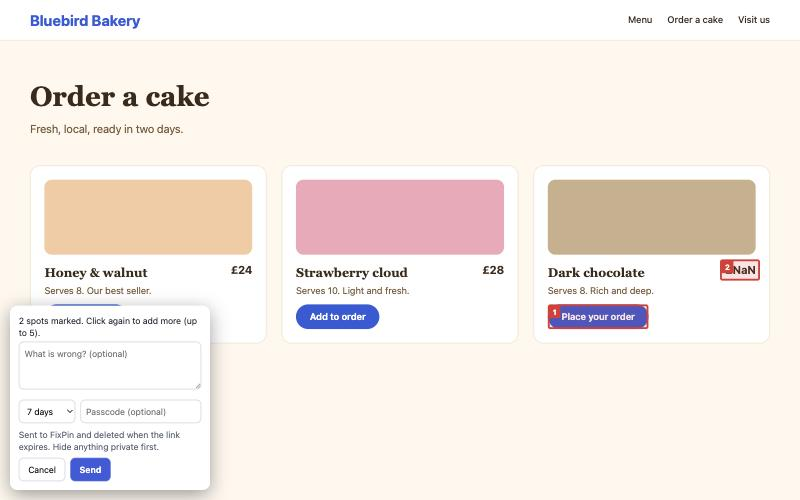

# The browser extension

The extension works in Chrome, Edge, Brave and Firefox.

## Install

Until it is listed in the browser stores, install it from the [latest release](https://github.com/george-stathopoulos/fixpin-extension/releases/latest) or from the source:

- **Chrome, Edge, Brave:** open `chrome://extensions`, turn on **Developer mode**, choose **Load unpacked** and pick the extension folder.
- **Firefox:** open `about:debugging`, choose **This Firefox**, then **Load Temporary Add-on** and pick `manifest.json`.

## Use it

1. Go to the page with the problem.
2. Click the FixPin button, or press **Alt+Shift+F**.
3. If the problem needs a click to appear, reproduce it now.
4. Click the problem, or drag a box around it. Add up to 5 spots.
5. Write a note, choose how long the link lasts, and press **Send**. The link is copied.

## What comes with a report

The screenshot, your spots (with the page element each one is on), the page address and title, your screen size and browser, and any errors that happened **after** you clicked the button: JavaScript errors, failed requests, and console errors and warnings.

## What the extension can see

It only runs on the page you click it on (the `activeTab` permission). It does not read pages in the background, has no analytics, and sends nothing until you press **Send**.

It can't run on browser pages (such as `chrome://`) or on the extension stores.
