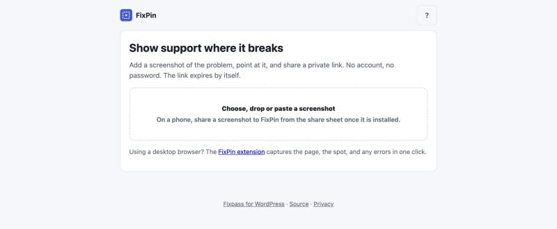
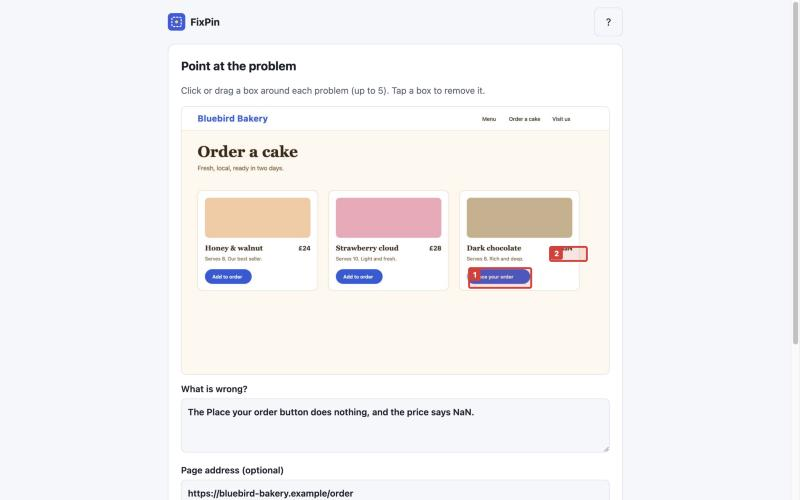
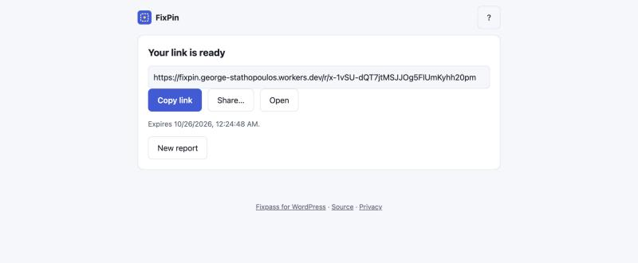

# Getting started

FixPin turns "the button doesn't work" into a screenshot with the broken spot marked, a note, and a private link that deletes itself. No account, no password.

## Two ways to use it

- **The app** works on any phone, tablet or computer. Open it, add a screenshot, mark the problem, get a link. Nothing to install.
- **The browser extension** works on a computer. It takes the screenshot of the page for you and adds the page address, your screen size and browser, and any errors from the page.

Both give you the same report page, and both are free.

## Your first report (the app)

1. Open the FixPin app and choose, drop or paste a screenshot. On a phone, take a screenshot and share it to FixPin once the app is installed.

2. Click or drag a box around each problem (up to 5). Click a box again to remove it.
3. Write what is wrong. Add the page address if you know it.

4. Choose how long the link works (1, 7 or 30 days) and, if you like, a passcode.
5. Press **Create link**, then **Copy link** and send it to whoever is helping you.

Whoever opens the link sees the [report page](sharing.md#what-the-report-page-shows).

## Install the app

On a computer, use your browser's install button in the address bar (Chrome, Edge). On iPhone, use Share → **Add to Home Screen**. On Android, use the menu → **Install app**. Once installed it opens like any other app and appears in your phone's share sheet.

## Using WordPress?

[Fixpass](https://george-stathopoulos.github.io/fixpass/) adds one thing FixPin deliberately does not do: it gives your support team safe, temporary administrator access to a WordPress site, with no password shared.
