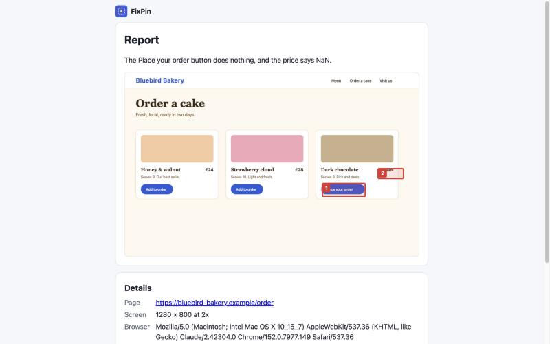

# Sharing a report

## The link

Every report has its own link, made of a random 192-bit code that can't be guessed. Anyone who has the link can open the report, so share it only with the people helping you.

## How long it lasts

You choose 1, 7 or 30 days. After that the report and its screenshot are deleted automatically.

## Passcode

Add a passcode to ask for one before the report opens. Tell the person the passcode separately from the link (a different message is best).

## Delete it early

Open the report on the device that created it and press **Delete now**. It is gone for everyone who had the link.

## What the report page shows

The screenshot with your numbered spots, your note, the page address, screen size and browser, any errors the extension collected, and a **Copy details** button that formats everything as plain text for an email or ticket.

## Size limit

A report can be up to 2 MB. The app shrinks large screenshots for you.
